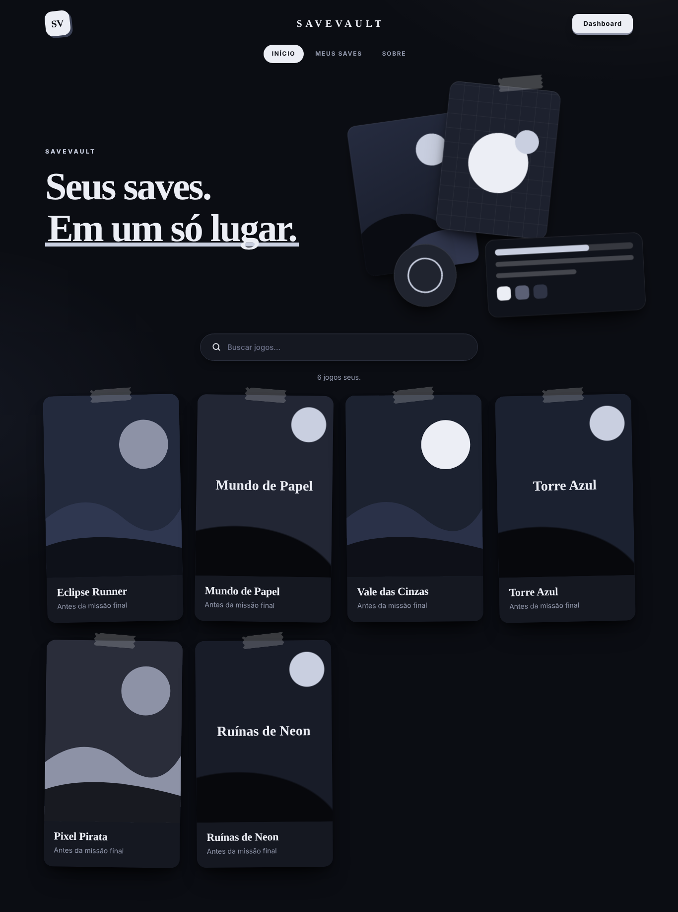
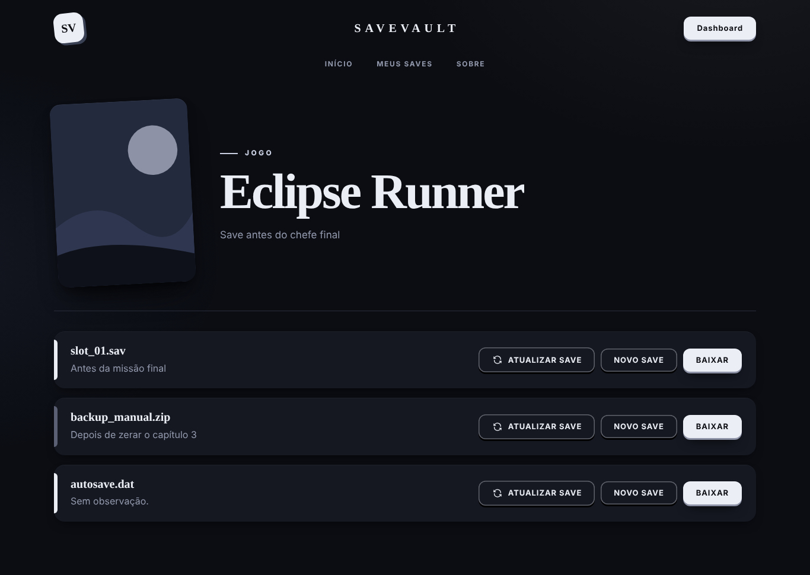
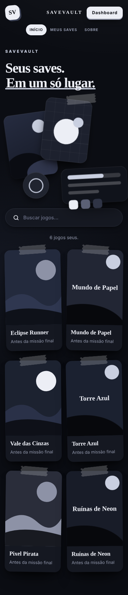

<div align="center">

# SaveVault

**Guarde, organize e baixe os saves dos seus jogos em um só lugar.**

[](https://save-pearl-three.vercel.app)




</div>

> As capturas de tela usam jogos e capas de exemplo.

## Sobre

O SaveVault é um site para quem quer manter os arquivos de save dos jogos organizados. Cada pessoa tem a sua própria conta e a sua biblioteca: cadastra o jogo, envia a capa e o save, e depois baixa, atualiza ou adiciona novas versões quando precisar.

## Recursos

- **Conta própria:** cadastro, login e logout com Supabase Auth.
- **Biblioteca de jogos:** cada jogo aparece com a sua capa, com busca por nome.
- **Upload completo:** envie o jogo, a capa e o primeiro save de uma vez, com observação.
- **Página do jogo:** lista todos os saves do jogo, com a observação de cada um.
- **Baixar, atualizar e adicionar:** baixe um save, substitua por uma versão nova ou mantenha o antigo e adicione outro.
- **Privacidade:** as capas ficam em um bucket privado e são exibidas por URL assinada. O banco usa RLS para cada pessoa acessar apenas os seus dados.
- **Visual:** tema escuro, cartas de jogo com inclinação 3D, layout responsivo e respeito à opção "reduzir movimento" do sistema.

<div align="center">
  
  
</div>

## Tecnologias

| Área | O que foi usado |
| --- | --- |
| Interface | HTML, CSS e JavaScript puro, sem frameworks nem bibliotecas de animação |
| Autenticação | Supabase Auth |
| Banco de dados | Supabase (PostgreSQL) com RLS. Tabelas `profiles`, `games` e `saves` |
| Arquivos | Supabase Storage. Buckets `game-covers` e `save-files`, com URLs assinadas para as capas |
| Publicação | Vercel |

## Estrutura

```
save/
├── index.html        # Biblioteca de jogos (início)
├── dashboard.html    # Painel: meus jogos e envio de novos jogos
├── game.html         # Página de um jogo e seus saves
├── login.html        # Entrar
├── signup.html       # Criar conta
├── sobre.html        # Sobre o projeto
├── css/style.css     # Estilos
├── js/
│   ├── app.js        # Lógica: autenticação, Supabase e páginas
│   └── fx.js         # Efeitos visuais: inclinação 3D e parallax
├── docs/screenshots/ # Imagens do README
└── favicon.svg
```

## Rodando localmente

O projeto é estático, mas precisa ser aberto por um servidor local para o login funcionar direito.

```bash
git clone https://github.com/Marcello-ribeiro/save.git
cd save
python -m http.server 8000
```

Depois acesse http://localhost:8000.

### Usando o seu próprio Supabase

1. Crie um projeto no [Supabase](https://supabase.com).
2. Crie as tabelas `profiles`, `games` e `saves` e ative o RLS, de modo que cada usuário acesse só as suas linhas.
3. Crie os buckets privados `game-covers` e `save-files`.
4. Em `js/app.js`, troque `SUPABASE_URL` e `SUPABASE_KEY` pela URL e pela chave **publicável** do seu projeto.

> A chave publicável pode ficar no front-end, pois a segurança vem do RLS. Nunca coloque uma chave de serviço (`service_role`) no código.

## Licença

Distribuído sob a licença MIT. Veja o arquivo [LICENSE](LICENSE).
